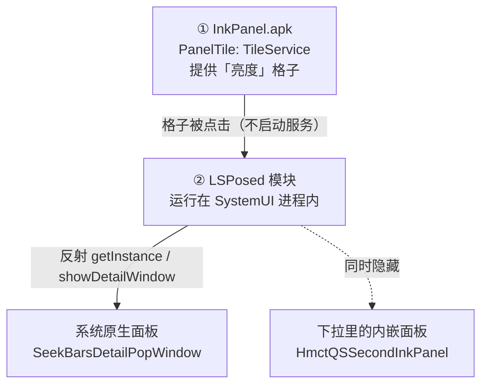

# InkPanel · 海信墨水屏「一键亮度面板」

把海信墨水屏设备下拉通知栏里那块占半屏的「亮度 / 色温 / 显示模式」面板，
收成一个快捷设置格子。点格子 → 通知栏收起 → 系统原生那块**五条滑杆**的悬浮面板浮到桌面上：

**亮度 · 色温 · 对比度 · 黑色 · 白色**

> 一个 APK + 一个 LSPosed 作用域，不刷机、不换 SystemUI、不改 ROM，全部可逆。

适配机型：**海信 Touch Lite（HITV205N）**，Android 11 / Vision UI。
同代 Vision 系统的其他海信墨水屏（A5 / A7 / A9）结构类似，但未验证。

---

## 一、效果

| 之前 | 现在 |
|---|---|
| 下拉里固定占一块：亮度滑杆 + 黑夜/手动/自动/关闭 + 色温滑杆 + 四种显示模式 | 下拉里只剩一个「亮度」格子，通知紧贴格子下方 |
| 想边看正文边调色温，做不到 | 点格子，面板浮在内容之上，**正文还看得见**，实时调 |

面板本身是系统原生的（`KEYGUARD_DIALOG` 类型窗口，`NOT_TOUCH_MODAL`，面板外仍可点击）。
本项目没有重画 UI，只是给了它一个新的入口。

---

## 二、架构

两层，比看起来简单：



### 关键点：点击是在 SystemUI 里接管的

磁贴的 `TileService` **不会被启动**。模块 hook 了 `QSTileImpl#click()`，
在点击事件进入框架、还没走到"启动服务"那一步时就把事件截走：

```
before click(tile):
    if tile 是 CustomTile 且 mComponent.package == com.zuakeo.inkpanel:
        setResult(null)          // 拦掉原逻辑，服务不会被拉起
        togglePanel()            // 直接调面板
```

这是 v0.2 的核心改动。v0.1 走的是"让磁贴正常启动 `TileService`"，但海信会拦第三方服务的
启动（详见「踩过的坑」第 6~8 条），导致重启或进程被杀后磁贴就哑了。
改成在 SystemUI 内部接管后，**不再依赖应用进程、不需要服务绑定、不需要任何开机脚本**——
应用从未运行过也能用。

### 数据流

```
用户点「亮度」格子
  → SystemUI QSTileImpl.click()
  → [模块拦截] 判断是不是我们的 tile
  → SeekBarsDetailPopWindow.getInstance(ctx)
  → isShowing() ? closeDetailWindow() : (collapsePanels(); showDetailWindow())
  → 面板出现在桌面下方，点第二次关闭
```

---

## 三、逆向出来的关键事实

这些是从 `Vision_SystemUI.apk` 的 `classes.dex` 里挖出来的（`dexdump`），也是整个项目的地基：

| 对象 | 值 |
|---|---|
| 悬浮面板类 | `com.hmct.systemui.qs.ink2.inkdetails.SeekBarsDetailPopWindow` |
| 获取实例 | `public static SeekBarsDetailPopWindow getInstance(Context)`（单例） |
| 显示 / 关闭 / 查询 | `public void showDetailWindow()` / `closeDetailWindow()` / `boolean isShowing()` |
| 悬浮窗口名 | `Ink2DetailWindow`，`ty=KEYGUARD_DIALOG`，720×1392，`NOT_TOUCH_MODAL` |
| 下拉里的内嵌面板 | `com.hmct.systemui.qs.ink2.HmctQSSecondInkPanel` |
| 内嵌面板容器 | `LinearLayout` id `0x7f0b0342`，固定高 704 |
| 外层头部 | `com.hmct.systemui.qs.HmctQuickStatusBarHeader`，固定高 828 |
| 磁贴基类 | `com.android.systemui.qs.tileimpl.QSTileImpl`，有 `click()` |
| 第三方磁贴 | `com.android.systemui.qs.external.CustomTile`，字段 `mComponent` |
| 快捷格子列表 | `Settings.Secure` 的 `sysui_qs_tiles`，`custom(pkg/cls)` 表示第三方磁贴 |
| 亮度 / 色温 / 显示模式 | `Settings.System` 的 `screen_brightness` / `screen_brightness_tctemp` / `current_epd_mode` |

> 注意：`HmctInkBrightnessTempContrast` 只是被布局文件引用，**实际从未被实例化**。
> 一开始 hook 它毫无反应，绕了很久（见坑 #3）。

---

## 四、怎么写的

**不使用 Gradle。** 全部用 SDK 自带工具直接拼，不联网、不拉依赖、可复现：

```
aapt2 compile → aapt2 link（顺便生成 R.java）
→ javac（--release 8，-encoding UTF-8）
→ d8 --min-api 30
→ python 注入 classes.dex 和 META-INF/xposed
→ zipalign
→ apksigner（debug keystore）
```

见 `build.sh`，一条命令出包。

**Xposed API 用自写桩编译。** `src/stubs/` 里手写了
`IXposedHookLoadPackage` / `XC_MethodHook` / `XposedBridge` / `XposedHelpers` 的签名，
编译时放在 classpath，**不打进 dex**（运行时由 LSPosed 提供真实实现）。
这样不用下载任何 xposed api jar。

**模块声明两套都带**，兼容新旧格式：
- `assets/xposed_init`（传统）
- `META-INF/xposed/java_init.list` + `module.prop`（LSPosed 新格式）

---

## 五、踩过的坑

按踩到的顺序，每条都花过时间。第 6~8 条现在已经**不适用**了（架构改了），
但保留下来，因为它们解释了为什么最终方案是"在 SystemUI 里接管点击"。

### 1. Xposed 桩的返回类型必须精确
`findAndHookMethod` 的真实返回值是 `XC_MethodHook.Unhook`，不是 `void`。
写成 `void` 会抛 `NoSuchMethodError`——**JVM 按完整签名匹配，返回类型算在内**。
报错只说"没有这个方法"，而方法明明在，极具误导性。

### 2. `findAndHookMethod("<init>")` 在 Vector 上不可用
海信这个 LSPosed 分支（Vector 2.2 / API 102）会报
`NoSuchMethodError: ...#<init>(...)#exact`。改用 `XposedBridge.hookAllConstructors` 才行。

### 3. 内嵌面板的真身不是布局里那个类
`hmct_ink_brightness_temp_contrast.xml` 的根节点是 `HmctInkBrightnessTempContrast`，
但运行时它**从未被实例化**。真正在跑的是 `HmctQSSecondInkPanel`。
判断依据是后者的字段：`mQsPanel` / `mExpanded` / `mBrightnessButtons` / `mColorSliders`。

### 4. `qs_show_brightness=0` 是死路
SystemUI 的 dex 里确实读这个键，配套字符串也有"在快捷设置中显示亮度栏"，
但改成 0 后**重启 SystemUI 也不生效**，别浪费时间。

### 5. 藏了面板之后会留一块空白
内嵌面板的容器是**固定高 704**，藏掉里面的内容不会缩。
必须把容器改 `wrap_content`，同时把外层 `HmctQuickStatusBarHeader` 的高度减去差值（828 → 426）。
只改其中一个都没用。

### 6. 海信的自启动策略会拦后台服务
```
W MobileSafeService: checkStartServicePerm ... com.zuakeo.inkpanel false
W autorun_as: Unable to launch app ... is restricted 3
```
新装应用"从未被使用过"时，服务启动会被拒。**磁贴照样显示，但点了完全没反应、也不报错**，
这是最坑的地方——没有错误日志可看。
更狠的是：**连 root 的 `am startservice` 也一样被拒**。

### 7. 绑定还要求"用户已解锁"
锁屏状态下预热 Activity 无效。必须等 `sys.user.0.ce_available=true` 之后才行。
官方文档里没有这个条件，是试出来的。

### 8. 开机早期解析失败会把磁贴丢掉
SystemUI 在开机很早的阶段创建磁贴，那时应用还没跑过 → 解析失败 → **磁贴从面板上消失**，
而且之后不会自动重试。光重启 SystemUI 也不够，必须**改一次 `sysui_qs_tiles`**
（删掉再加回）才会触发 `QSTileHost` 重建。

> 6/7/8 的最终解法不是"绕过"，而是**换架构**：既然服务起不来，就别让点击去启动服务。
> 直接 hook `QSTileImpl#click()` 在 SystemUI 内部接管，问题自然消失。

### 9. `install -r` 会重置待机分组
重装后待机分组回到 `RESTRICTED(50)`，磁贴失效。这条在 v0.2 之后不再影响功能。

### 10. javac 默认按 GBK 读源码
中文环境编译带中文的 Java 源码会直接报错，必须显式 `-encoding UTF-8`。

### 11. 墨水屏 `screencap` 经常是旧帧
调试时截到的可能是几秒前的画面，容易误判"没生效"。
更可靠的方式是 `uiautomator dump` 读 UI 树，或者先按一次主页键触发刷新再截图。

### 12. Vector 的兼容层是裁剪过的
不是完整 Xposed API。`XposedHelpers` 里只有部分重载，用之前先 `dexdump` 确认方法确实存在。

---

## 六、构建

需要：JDK 17、Android SDK build-tools（含 aapt2 / d8 / apksigner）、python3。

```bash
bash build.sh
# 产物：dist/InkPanel-0.2.apk
```

`build.sh` 开头的 SDK / JDK 路径按本机改一下即可。

---

## 七、安装

```bash
adb install -r dist/InkPanel-0.2.apk
```

1. 在 **LSPosed / Vector** 里启用「水墨面板」，作用域勾 **System UI**
2. 重启设备
3. 下拉通知栏 → 长按格子进编辑 → 把「亮度」拖到第一排

完事。**不需要装任何 Magisk 模块**，重启后磁贴也能直接用。

> 应用本身没有桌面图标（故意去掉的），它只以「快捷设置格子」的形式存在。

---

## 八、卸载

```bash
adb uninstall com.zuakeo.inkpanel
```

在 LSPosed 里关掉模块，重启。
唯一被改过的系统设置是 `sysui_qs_tiles`（把原来的 `float` 悬浮球换成了本模块），想恢复：

```bash
adb shell settings put secure sysui_qs_tiles \
  "wifi,bt,soundmode,collectarticle,rotation,dynamicrefresh,float,readmode,mutualtrans,pinscreen"
```

---

## 九、已知限制

- 只在这一个机型 / 一个 ROM 版本上验证过。海信改版后类名或布局一变就得重新逆向。
- 磁贴冷启动约 1~2 秒（墨水屏全刷），比原生格子慢。
- 面板位置和尺寸由系统决定，本项目没动。
- 依赖 LSPosed/Vector。没有 Xposed 环境就用不了。

---

## 十、开发说明

这个项目是**用 WorkBuddy 写的**，模型 **DeepSeek-V4.1-Flash**。

人负责：提需求、在真机上点、反馈"这个不对"。
AI 负责：反编译定位、写代码、搭构建脚本、跑 adb 验证、改到能用。

过程不是一次成型。v0.1 走的是"让磁贴正常启动服务"的路，为此还写了一个 Magisk 模块，
在开机解锁后预热应用、强制重建磁贴列表——但那套很脆：应用进程一被杀，磁贴就又哑了。
v0.2 换思路，改成在 SystemUI 里直接接管点击，Magisk 模块整个删掉，反而更简单也更稳。

上面 12 个坑基本都是"先写错、跑一遍、看日志、再改"逼出来的。
单是"为什么磁贴点了没反应"这一条，前后重启了七八次，才定位到是
`MobileSafe` + 解锁状态 + 磁贴被丢弃三个原因叠加，最后发现根本不该走那条路。

如果这段对你有用：**这类项目里，AI 的价值不在于一次写对，而在于能不烦不躁地把
"打日志 → 读日志 → 改假设 → 再试"这个循环跑完，并且敢推翻自己前面的方案。**

---

## 十一、免责声明

- 涉及 LSPosed / 系统私有接口，存在风险，自行承担。
- 仅供个人学习研究，不保证适配其他机型。
- 本项目不包含任何海信私有代码或资源，只通过反射调用系统中已存在、可公开访问的方法。

## License

MIT
